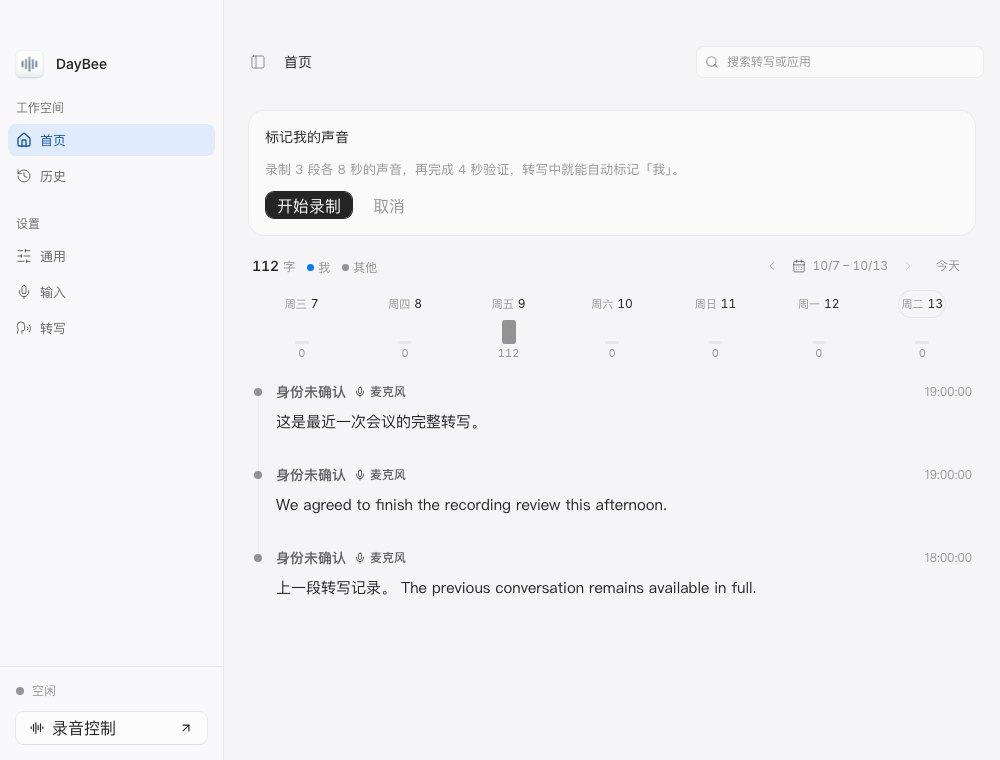

# DayBee

中文 | [English](README.md)

DayBee 是使用 Go 和 mygo 构建、以托盘常驻为核心的桌面录音应用。它可以长时间录制麦克风、自动分段存档，并使用可选择的 `sherpa-onnx` ASR 模型与 Silero VAD 做实时转写和离线补转写。

## 功能特性

- 长时间麦克风录音与自动分段
- 支持轻量 Whisper Tiny/Base/Small、SenseVoice Small、Qwen3 ASR 0.6B 和 FireRedASR2 AED/CTC 的实时转写（可关闭）
- 仅语音录制模式 — 仅保存 VAD 检测到的语音片段
- 实时音频波形可视化
- 手动选择麦克风，并可自动切到更活跃的输入设备
- macOS 原生回声消除，减少电脑外放声音进入录音和转写
- 可选录制 macOS 系统声音，与麦克风分别存储、转写并展示来源
- 同时支持 WAV 与 FLAC 输出
- 支持对已有 WAV/FLAC 录音做批量转写
- 按天分组的录音历史浏览
- 在转写文稿旁标注同时间段的应用名称和图标，支持按应用场景筛选转写与录音
- 系统托盘应用，支持开机自启、启动即录、自动更新
- 中英双语界面
- 亮色 / 暗色 / 跟随系统主题

## 桌面应用预览



## 下载

- 发布页面：[DayBee Releases](https://github.com/nexmoe/eve/releases)
- macOS 13.3+：Apple Silicon / Intel `.dmg`
- Windows：`.exe`（NSIS 安装包）

应用启动时及每六小时检查签名更新，在录音和批量转写均空闲后安装并重启。从 Electron 首次升级需要手动安装，详见[迁移验证与升级说明](docs/migration-verification.md)。迁移版本须通过全部验收门槛后才能发布。

## 运行说明

- 首次启动默认使用轻量 Whisper Tiny（INT8），也可在「转写」设置中选择 Whisper Base/Small、SenseVoice Small（2025）、Qwen3 ASR 0.6B 或 FireRedASR2 AED/CTC。已有模型选择保持不变。页面展示下载量、进度和安装状态；录音期间可切换，待处理语音继续使用原模型转写。
- 开始录音时准备 Silero VAD；选定模型时或首次实时、批量转写时下载对应 ASR 模型。已有模型缓存继续复用，下载失败时保留原选择。
- 原生采集、sherpa-onnx 1.13.8 和 ONNX Runtime 1.28.2 随应用打包，安装后无需 Node.js、Bun 或 Go。
- WAV/FLAC 编解码、声道混合和重采样直接由 Go 完成，兼容旧版 FLAC 录音，无需 FFmpeg 可执行文件或系统安装。
- macOS 默认开启回声消除，已有配置也会自动补上此默认值。需要原始音频时可在「输入」中关闭。回声消除与自动切换输入可同时开启，切换后继续进行回声消除；设备断开后仍可恢复至默认输入。详见[回声消除说明](docs/subsystem/audio.md)。系统声音录制默认关闭，可在同一页面开启；详见[系统声音说明](docs/subsystem/audio.md)。
- 麦克风应用识别在 DayBee 运行期间独立工作，无需开始录音，每秒检查一次；Mac 需 macOS 14.2+。活动记录按日保存在应用数据目录的 `microphone-activity/` 中，详见[麦克风活动记录说明](docs/subsystem/microphone-activity.md)。

## 输出内容

- 音频和同名 JSON 会按日期归档到 `recordings/YYYYMMDD/`
- 文件名形如 `daybee_YYYYMMDD_HHMMSS.wav` 或 `.flac`
- 开启 ASR 时，分段写出同名 `.json` 保存转写文本和元数据；关闭 ASR 时保存音频及不含转写文本的采集时间元数据

示例 JSON：

```json
{
  "audio_file": "daybee_20260201_120513.wav",
  "audio_path": "/path/to/recordings/20260201/daybee_20260201_120513.wav",
  "backend": "sherpa-onnx",
  "created_at": "2026-02-01T12:05:13.000Z",
  "input_device": "MacBook Air Microphone",
  "model": "Qwen3 ASR 0.6B",
  "segment_start_time": "2026-02-01T12:05:13.000Z",
  "status": "ok",
  "text": "请起来活动一下。"
}
```

## 更多文档

- [子系统参考](docs/subsystem/README.md)
- [更新日志](CHANGELOG.md)
